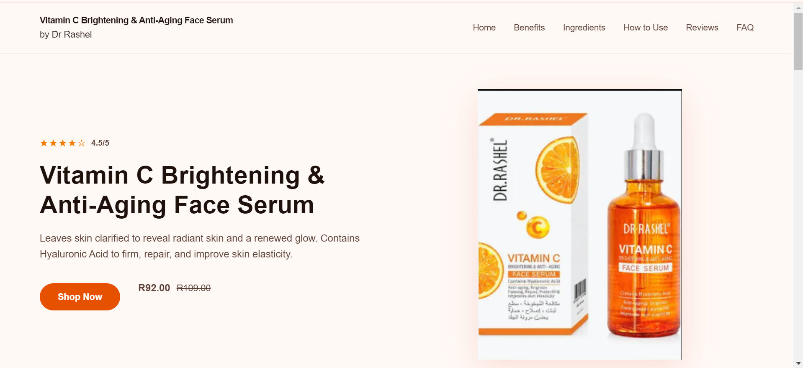
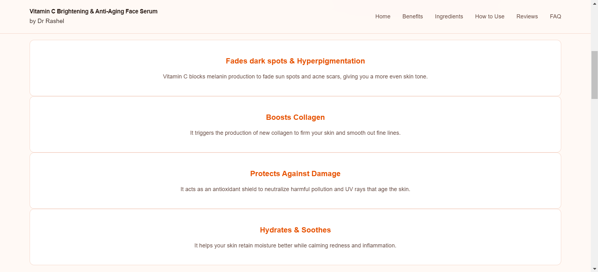
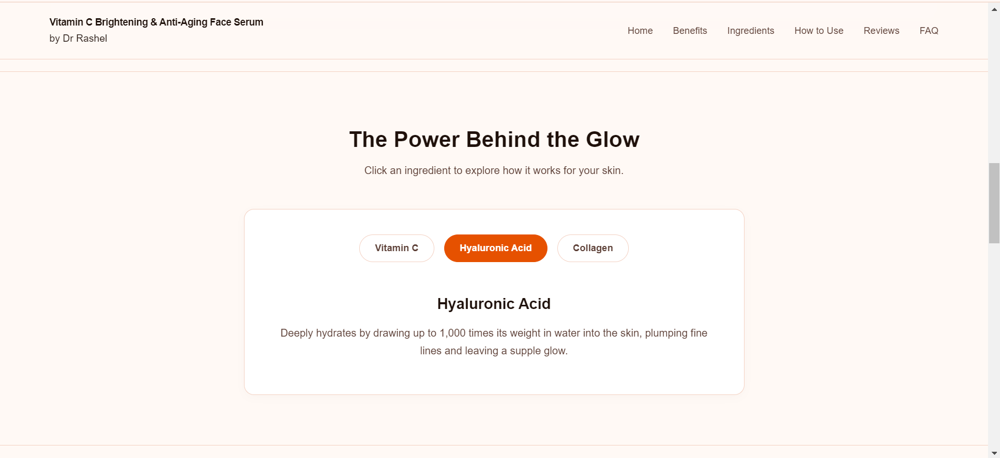
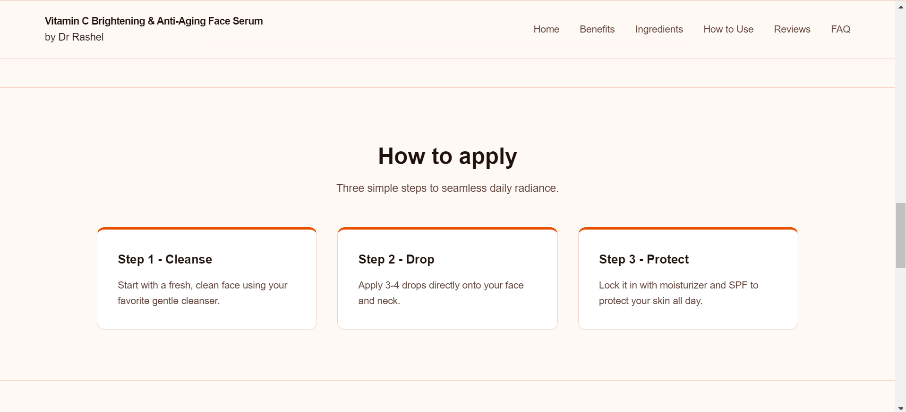
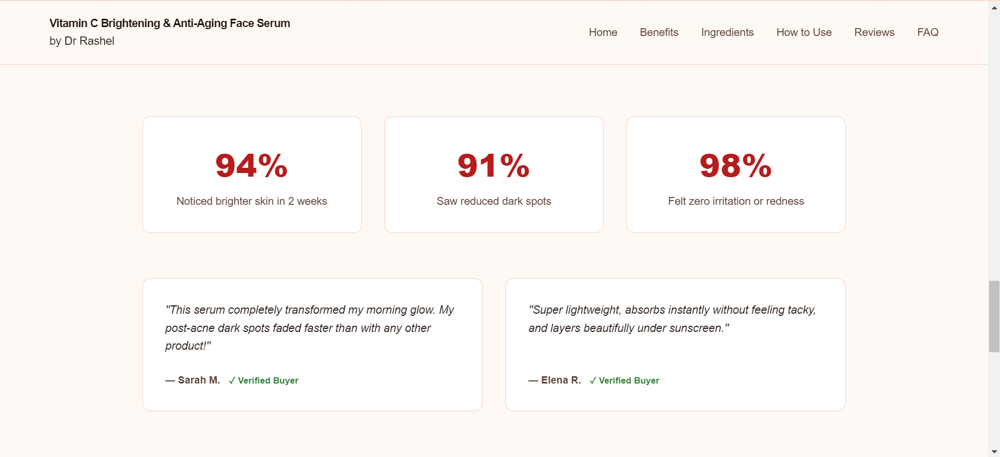
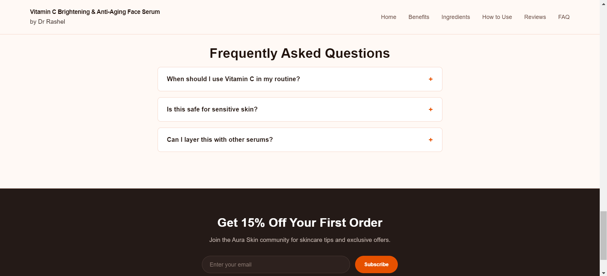

# Dr Rashel Vitamin C Serum — Landing Page

A minimalist, editorial, and responsive sunset-themed landing page built for the **Dr Rashel Vitamin C Brightening & Anti-Aging Face Serum**.

## 📑 Table of Contents

1. [Key Features](#-features)
2. [Preview & Screenshots](#-preview--screenshots)
3. [Project Overview](#-project-overview)
4. [Content & Copywriting Strategy](#%EF%B8%8F-content--copywriting-strategy)
5. [Tech Stack](#%EF%B8%8F-tech-stack)
6. [File Structure](#-file-structure)
7. [Educational Disclaimer](#%EF%B8%8F-educational-disclaimer)

---

## 📸 Preview & Screenshots

### 1. Hero Section (Home)


### 2. Key Benefits


### 3. Interactive Ingredients


### 4. Application Steps


### 5. Customer Reviews & Stats


### 6. FAQ Accordion


---

## 🚀 Features
* **Editorial Sunset Palette:** High-contrast color scheme utilizing warm off-whites, vibrant sunset oranges, and rich crimson reds.
* **Interactive Ingredient Switcher:** Dynamic tab system that updates ingredient details on the fly.
* **Collapsible FAQ Accordion:** Clean, interactive FAQ section built with vanilla JavaScript.
* **Fully Responsive:** Optimized for mobile, tablet, and desktop viewports.

---

## ✍️ Content & Copywriting Strategy

The landing page copy is structured following standard direct-to-consumer (DTC) e-commerce frameworks to drive conversions and deliver clear vertical storytelling:

### 1. Header & Navigation
* **Brand Identity:** Clear attribution to *Dr Rashel* with product line title (*Vitamin C Serum*).
* **Navigation Links:** Jump links to key sections (`#hero`, `#benefits`, `#ingredients`, `#how-to-use`, `#reviews`, `#faq`).
* **Header CTA:** Quick-action button for immediate purchase intent.

### 2. Hero Section
* **Hook:** Highlighting core claims (*Brightening*, *Anti-Aging*, *Elasticity*).
* **Social Proof Badge:** Real customer star rating (4.5/5) to immediately build trust.
* **Pricing Anchor:** Displaying current promotional price (`R92.00`) alongside original retail price (`R109.00`).

### 3. Benefits & Ingredients
* **Value Cards:** 4 bite-sized benefit highlights (Fades dark spots, Boosts collagen, Protects against damage, Hydrates & soothes).
* **Science Spotlight:** Highlighting key active ingredients including *Pure Vitamin C*, *Ferulic Acid*, and *Hyaluronic Acid*.

### 4. Application & Social Proof
* **3-Step Routine:** Simplifying application into clear steps (*Cleanse ➔ Drop ➔ Protect*).
* **Customer Stats:** High-impact satisfaction metrics (e.g., 94% noticed brighter skin).
* **Verified Reviews:** First-hand feedback with verified buyer badges to handle consumer hesitation.

### 5. Objection Handling & Retention
* **FAQ Accordion:** Answering top customer queries regarding routine placement, skin sensitivity, and layering.
* **Footer CTA:** Email subscription lead-capture offering a 15% discount code for community building.

---

## 📌 Project Overview

This project showcases a clean, single-page landing page designed with pure **HTML5**, **CSS3**, and modern **JavaScript**. It focuses on vertical storytelling, smooth navigation, interactive product highlights, and a warm sunset color palette (orange, red, and cream).

### Key Features
* **Hero Section:** Clear call-to-action, star ratings, and real product pricing.
* **Benefits Grid:** Quick summary of key skincare perks.
* **Interactive Ingredient Tabs:** JS-powered tab switching for key ingredients.
* **How-to-Use Guide:** Step-by-step application instructions.
* **Social Proof & Stats:** Customer stats and verified review cards.
* **FAQ Accordion:** Interactive dropdowns for common questions.
* **Footer & Newsletter:** Lead-capture form and copyright details.

---

## 🛠️ Tech Stack

* **HTML5:** Semantic document structure.
* **CSS3:** Custom properties (CSS variables), Flexbox/Grid layouts, and responsive media queries.
* **JavaScript (Vanilla):** DOM manipulation for interactive tabs and accordions.

---

## 📁 File Structure

```text
├── index.html        # Main HTML structure
├── style.css         # Custom styling & responsive layout
├── script.js        # Dynamic interactive features
└── images/           # Product assets and images
```

---

## ⚠️ Educational Disclaimer
**Note:** This project is created strictly for **educational and portfolio purposes**. All product names, logos, images, and brand assets associated with **Dr Rashel** belong to their respective copyright holders. This site is not affiliated with, endorsed by, or connected to Dr Rashel.